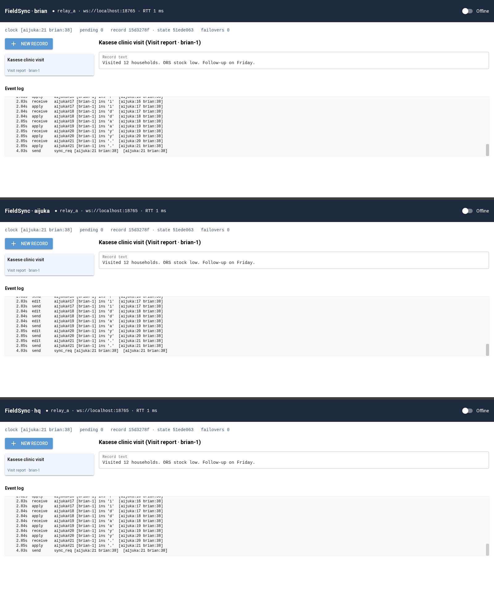
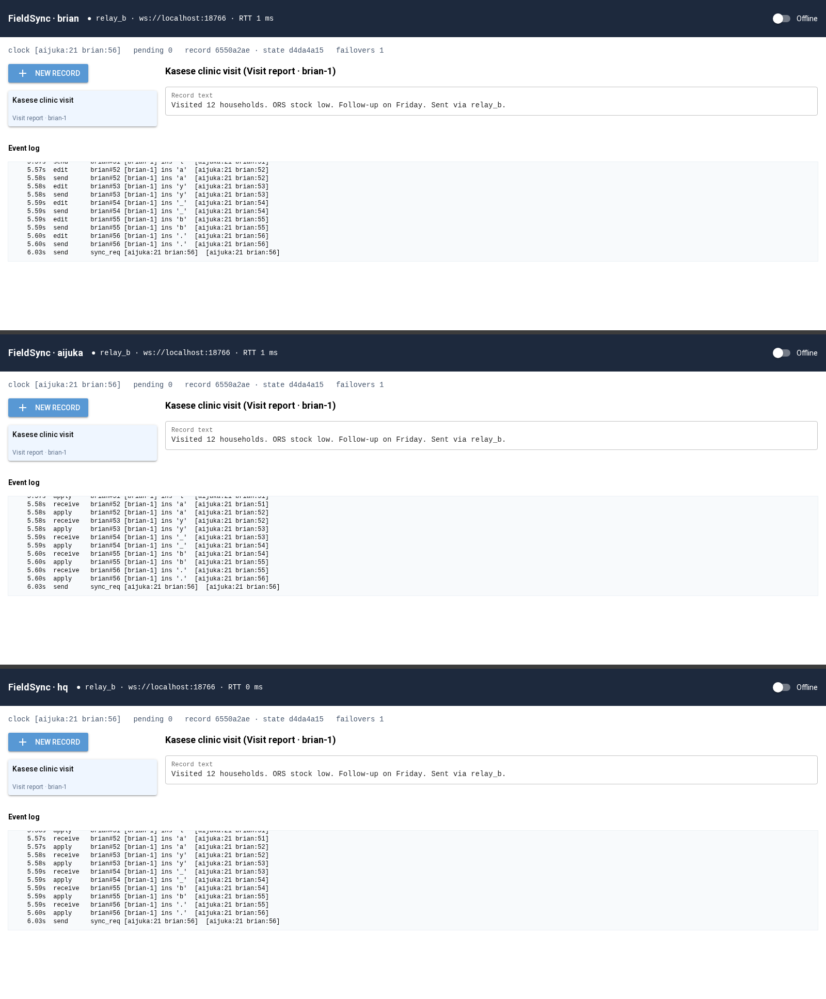
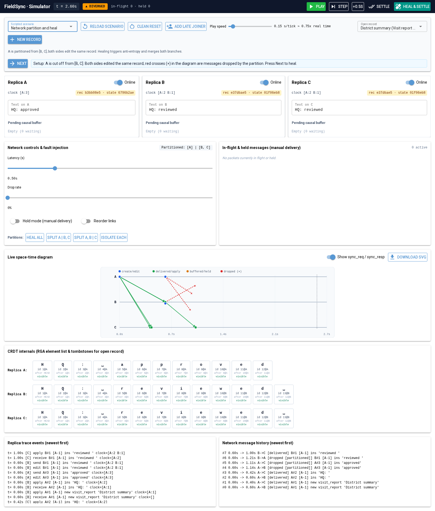
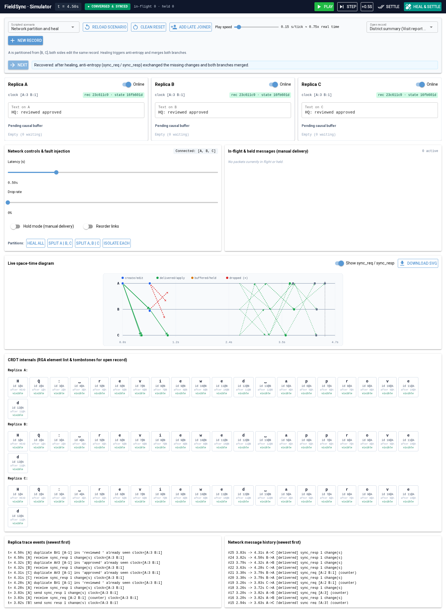

# FieldSync

A fault-tolerant collaborative records editor for a community health NGO whose field offices
have unreliable connectivity.

Field officers and HQ staff create, open and edit shared records (visit reports and case
notes), even at the same time, and even while offline. Every laptop runs an **editor node**
that holds a full copy of every record. Edits apply instantly on that copy and sync in the
background through two **relay servers**, so a relay crash, a hung relay or a lost connection
never stops anyone working. Concurrent edits are merged without locks by a CRDT (an RGA
sequence with Lamport IDs, vector clocks and causal delivery), so every copy ends up
identical. A simulator shows what happens inside.

BSE 4103 / BCS 3107 Distributed Systems group project: TUMWESIGYE BRIAN (23/2/370/W/552) and
ARINAITWE AIJUKA (23/2/370/W/143).

**Contents:** [Setup](#setup) · [Run on one laptop](#run-on-one-laptop) ·
[What to try](#what-to-try) · [Run across several laptops](#run-across-several-laptops) ·
[Scalability](#scalability) · [Run the simulator](#run-the-simulator) ·
[Tests](#tests) · [Project layout](#project-layout)

---

## Setup

You need **Git** and **uv** (a Python project manager). uv downloads the right Python version
(3.12) by itself, so you don't need to install Python.

### Linux

```bash
sudo apt install git                              # or your distribution's package manager
curl -LsSf https://astral.sh/uv/install.sh | sh   # then open a new terminal
git clone https://github.com/rw3h4/fieldsync.git
cd fieldsync
uv sync
uv run pytest                                     # all tests should pass
```

### Windows (PowerShell)

```powershell
winget install --id Git.Git -e
winget install --id astral-sh.uv -e
# close PowerShell and open a new window, so the new commands are found
git clone https://github.com/rw3h4/fieldsync.git
cd fieldsync
uv sync
uv run pytest
```

Every command below is the same on Linux and Windows unless noted. Each long-running process
(a relay or a node) needs its **own terminal window**: open a new terminal, `cd fieldsync`, and
run the command there.

---

## Run on one laptop

Two relays and three editor nodes, each in its own terminal:

```bash
uv run relay --id relay_a --port 8765 --peer ws://localhost:8766 --log-file data/relay_a.jsonl
uv run relay --id relay_b --port 8766 --peer ws://localhost:8765 --log-file data/relay_b.jsonl
uv run node --id brian  --port 8081 --relays ws://localhost:8765,ws://localhost:8766 --data-file data/brian.jsonl
uv run node --id aijuka --port 8082 --relays ws://localhost:8765,ws://localhost:8766 --data-file data/aijuka.jsonl
uv run node --id hq     --port 8083 --relays ws://localhost:8765,ws://localhost:8766 --data-file data/hq.jsonl
```

Then open http://localhost:8081, http://localhost:8082 and http://localhost:8083 side by side.
Each page is one user's editor.

What the options mean:

| Option | Meaning |
|---|---|
| `--id` | A unique name for this relay or node (letters, digits and underscores) |
| `--port` | The port it listens on. A node's page is served on this port |
| `--peer` | The other relay, so the two relays keep each other up to date |
| `--relays` | The relays a node may use, in order of preference. It starts on the first and fails over to the next |
| `--log-file` / `--data-file` | Where the relay or node saves its changes, so it recovers after a restart |

Press **Ctrl+C** in a terminal to stop that process.

---

## What to try

**Create and find records.** Click **New record** on one page, give it a title and a type.
It appears on the other pages within about a second. Click a record to open it.

**Edit together.** Open the same record on two pages and type in both at once. Both pages end
up with the same text, and the **digest** in each status bar matches, which means the copies
are identical.

**Keep working offline.** Turn on a page's **Offline** switch. Keep editing there and on
another page, including the same record. Turn it off again: everything merges, and nothing
typed while offline is lost.

**Read the status bar.** Each page shows which relay it is connected to (or OFFLINE), the
round-trip time, its vector clock, the number of changes waiting for dependencies, and the
record digest.

**Survive a relay crash.** Press Ctrl+C on `relay_a`. Every page switches to `relay_b` at once
and its failover count goes up. Keep editing: changes still reach everyone. Pages stay on
`relay_b` when `relay_a` comes back, so they don't flip back and forth.

<table>
  <tr>
    <td></td>
    <td></td>
  </tr>
  <tr>
    <td align="center"><em>Before: all three nodes on relay_a, 0 failovers</em></td>
    <td align="center"><em>After stopping relay_a: all on relay_b, 1 failover, digests still match</em></td>
  </tr>
</table>

**Survive a hung relay** (Linux and macOS). A hung relay keeps its connections open but stops
answering, so only the missing heartbeats reveal it:

```bash
kill -STOP $(pgrep -f "relay_b")    # freeze the relay the pages are on; about 3 s later they move
kill -CONT $(pgrep -f "relay_b")    # unfreeze it afterwards
```

**Recover after a restart.** Stop a relay or a node and start it again with the same
`--log-file` or `--data-file`: it reloads everything, including edits made offline, and
catches up on anything it missed.

| Assignment requirement | Where to see it |
|---|---|
| Submit records | New record |
| Retrieve records | The record list on every page |
| Update records concurrently | Editing the same record on two pages |
| Work through network loss | The Offline switch, or turning Wi-Fi off |
| Continue when a server fails | Stopping or freezing a relay |

### Two rules

**Every node and relay needs its own `--id`.** Never run two with the same ID. If a node loses
its data file, start it with a new ID. Change IDs are built from the node ID and a counter, so
a reused ID would reuse change IDs and break convergence.

**To reset, stop everything and delete the whole `data/` folder.** Never delete a single
node's file while the relays still have their logs: the relays would still hold that node's
old changes.

---

## Run across several laptops

FieldSync runs the same way on any number of laptops on one network. **Two laptops host the
relays; every laptop runs one editor node** (or several). Every node lists both relays by their
network address.

### 1. Put every laptop on the same network

Use a **phone hotspot** or a router you control. Campus and other managed Wi-Fi often blocks
traffic between devices ("client isolation"), so the laptops can't see each other even with
the right addresses.

### 2. Find the addresses of the two relay laptops

- Linux: `hostname -I` (the first address)
- Windows: `ipconfig` (the "IPv4 Address" of the Wi-Fi adapter)

The examples below use `192.168.43.10` for relay laptop A and `192.168.43.20` for relay laptop
B. Replace them with yours.

### 3. Start the relays

On **laptop A**:

```bash
uv run relay --id relay_a --port 8765 --peer ws://192.168.43.20:8766 --log-file data/relay_a.jsonl
```

On **laptop B**:

```bash
uv run relay --id relay_b --port 8766 --peer ws://192.168.43.10:8765 --log-file data/relay_b.jsonl
```

### 4. Start one node on every laptop

The command is the same everywhere except `--id` and `--data-file`, which must be unique:

```bash
uv run node --id field1 --port 8081 --relays ws://192.168.43.10:8765,ws://192.168.43.20:8766 --data-file data/field1.jsonl
```

For example, with four laptops:

| Laptop | Runs | Node command uses |
|---|---|---|
| A (`192.168.43.10`) | `relay_a` + a node | `--id brian` |
| B (`192.168.43.20`) | `relay_b` + a node | `--id aijuka` |
| C | a node only | `--id field1` |
| D | a node only | `--id hq` |

Each user opens `http://localhost:8081` on their own laptop.

**More users than laptops?** One laptop can run several nodes. Give each its own `--id`,
`--port` and `--data-file` (for example ports 8081, 8082, 8083), and open each port in its own
browser tab.

### 5. Allow the connections through the firewall

- **Windows:** when "Windows Defender Firewall has blocked some features" appears for Python,
  allow it on **private networks**, and set the Wi-Fi network's profile to **Private**.
- **Linux:** if a firewall is active, open the relay ports and the node page, for example
  `sudo ufw allow 8765:8766/tcp` and `sudo ufw allow 8081/tcp`.

### 6. Check before you start (30 seconds)

From any other laptop's browser, open laptop A's node page, for example
`http://192.168.43.10:8081`. If it loads, the laptops can reach each other. Then check that
every node's status bar shows a relay, not OFFLINE.

To demonstrate failover across machines, stop or freeze the relay on laptop A: every node
moves to the relay on laptop B. To demonstrate offline work for real, turn one laptop's Wi-Fi
off, keep editing on all of them, and turn it back on.

The reset rule applies on every laptop: stop every relay and node on all of them, then delete
the `data/` folder on each.

---

## Scalability

**Why it scales.** Relays only store and forward: each change goes once to every other node,
and relays never merge text, so adding users adds little relay work. All conflict handling
happens on the users' own laptops, in parallel. Any number of nodes can join, including late
joiners, which catch up by replaying the relay's log.

**What we measured.** On one laptop (Intel i5-1135G7, 8 logical CPUs, Linux), with real relay
processes and persistence on, each test run 3 times:

| Clients | Edits per second (total) | Median sync latency | 95th percentile |
|---|---|---|---|
| 2 | 2 | 1.8 ms | 2.3 ms |
| 4 | 20 | 2.5 ms | 3.4 ms |
| 8 | 40 | 3.5 ms | 6.1 ms |
| 16 | 160 offered, 151 achieved | 5.6 ms | 19.2 ms |

In every run, 100% of changes reached every node and all copies ended identical. A crashed
relay was recovered from in about 55 ms, a hung relay in about 2.95 s, and 30 s of offline
edits synced within 0.14 s of reconnecting. The relays used about 4–5% CPU each at the highest
load. The main limit is per-node work: applying a remote insert costs time proportional to the
document's size. Full method, results and interpretation: [docs/EVALUATION.md](docs/EVALUATION.md).

**Reproduce the measurements:**

```bash
uv run loadgen --all --runs 3            # about 20 minutes; the hang test runs on Linux/macOS only
uv run loadgen-report                    # results/summary.md
uv run --group eval loadgen-charts       # charts in results/charts/ (add --slides for projector-size)
```

A single test: `uv run loadgen --test P2 --runs 1` (about 40 seconds).

---

## Run the simulator

```bash
uv run sim
```

Open the address it prints (http://127.0.0.1:8080/). It runs two to four replicas in one
process over a virtual network you control, so concurrency and failures can be slowed down
and seen:

- each replica's text, vector clock and convergence badge;
- network controls: latency, message loss, reordering, partitions, offline replicas, and a
  hold mode for delivering messages by hand, in any order;
- a live space-time diagram of every message (downloadable as SVG);
- the buffer of changes waiting for their dependencies, and the CRDT's internal character list;
- seven scripted scenarios (concurrent inserts, insert and delete, out-of-order delivery,
  partition and heal, offline editing, late joiner, message loss), stepped through with
  **Next**, at adjustable speed.

<table>
  <tr>
    <td></td>
    <td></td>
  </tr>
  <tr>
    <td align="center"><em>Partitioned: A is cut off, the texts diverge, and dropped messages show as red crosses</em></td>
    <td align="center"><em>After healing: sync exchanges the missing changes and all three replicas converge</em></td>
  </tr>
</table>

---

## Tests

```bash
uv run pytest
```

This runs unit tests, property-based tests (random edit histories delivered in random orders
with random faults, checking every replica converges), failure tests over real network
connections, and a short load-generator run. They run automatically on every push, on Linux
and Windows.

Browser tests for the editor are skipped unless Chromium is installed:

```bash
uv run playwright install chromium
uv run pytest
```

---

## Project layout

| Folder | Contents |
|---|---|
| `fieldsync/crdt/` | The CRDT: character IDs, Lamport and vector clocks, the RGA text structure |
| `fieldsync/runtime/` | The replica: causal delivery, sync between replicas, messages |
| `fieldsync/net/` | Network mode: relays, nodes, failover, saved logs |
| `fieldsync/ui/` | The node page and the simulator page |
| `fieldsync/sim/` | The simulated network and the scripted scenarios |
| `fieldsync/eval/` | The load generator, metrics and charts |
| `tests/` | The automated tests |
| `results/` | Evaluation results, summary and charts |
| `docs/` | [Evaluation](docs/EVALUATION.md), [design decisions](docs/DECISIONS.md), [message formats and interfaces](docs/INTERFACES.md), [development log](docs/DEVLOG.md) |

Setup for contributors is in [CONTRIBUTING.md](CONTRIBUTING.md).
