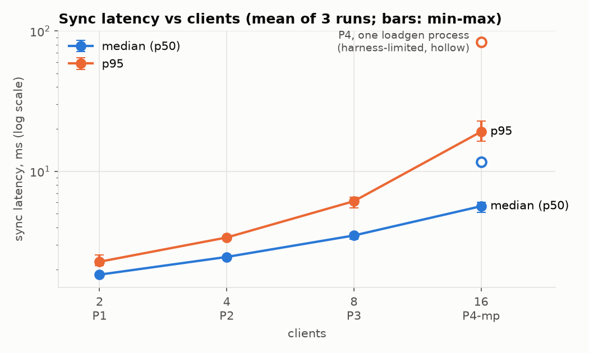
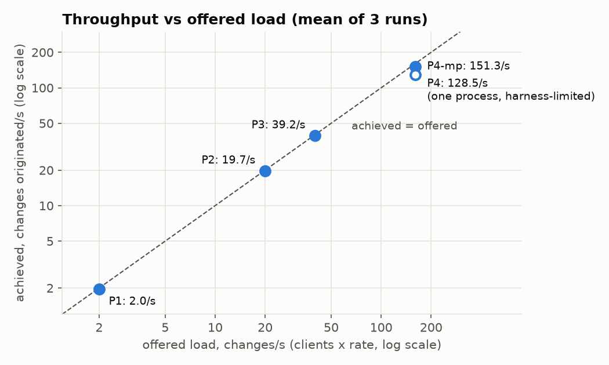
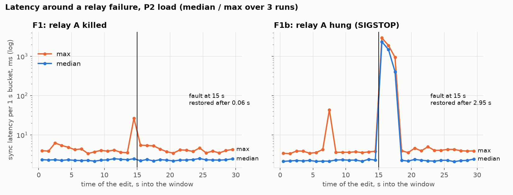
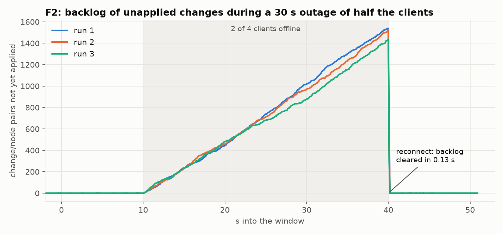

# FieldSync performance and scalability evaluation (task e)

Draft for the report (M4, 2026-11-23). Every number below comes from `results/runs.csv`
(one row per run), summarised in `results/summary.md`; the charts are in `results/charts/`.
Decisions D40–D43 in `docs/DECISIONS.md` define the method.

**Key findings**

- **100% success and convergence in all 24 runs**: every change reached every node, and all replicas ended identical.
- **Latency stays low as clients grow**: p50 rose from 1.8 ms to 3.5 ms going from 2 to 8 clients (P1 → P3).
- **16 clients at 10 edits/s each are handled with p95 19.2 ms** when the harness isn't the bottleneck (P4-mp).
- **Relay failures recover fast, with no edits lost**: a crash in about 55 ms (F1), a hang in about 2.95 s (F1b, the heartbeat timeout).
- **Offline clients don't slow online ones**, and 30 s of offline edits sync within 0.14 s of reconnecting (F2).

## 1. Method

**System under test.** The real network mode, as a user would run it:

- two relays, **relay_a** and **relay_b**, as separate OS processes, peered with each other,
  each persisting its op log to a JSON Lines file (`--log-file`);
- N headless editor nodes (`fieldsync.net.Node`), each with its own data file, connected to
  `[relay_a, relay_b]` (so all start on relay_a), with the default timings: heartbeat every
  1 s, failover after 3 s without a pong, anti-entropy every 2 s.

Persistence is on because it is part of the system's fault tolerance, so its cost is measured.
All files live in a temporary directory that is deleted after each run, so every run starts
from an empty system (D40).

**Load generator** (`uv run loadgen`, D40). The nodes run in the load generator's process on
one asyncio event loop. Client 0 creates 4 shared records. Each client then edits at rate *r*
with exponential gaps (mean 1/*r*), seeded per client: 80% of edits insert 1–3 letters at a
random position, 20% delete 1–2 characters. There is a 5 s warm-up, then a 30 s measurement
window (50 s for F2). After that, edits stop and the run waits up to 15 s for convergence.
For P4-mp the 16 clients are spread over 4 worker processes (D43).

**Tests** (PROJECT_BRIEF.md M4, plus F1b and P4-mp, approved by the owner). Each ran 3 times:

| Test | Load | Fault |
|---|---|---|
| P1 | 2 clients × 1 edit/s | – |
| P2 | 4 × 5 | – |
| P3 | 8 × 5 | – |
| P4 | 16 × 10, one load-generator process | – |
| P4-mp | 16 × 10, 4 load-generator processes × 4 clients | – |
| F1 | P2 | relay_a **killed** (SIGKILL) 15 s into the window |
| F1b | P2 | relay_a **hung** (SIGSTOP) 15 s into the window; sockets stay open |
| F2 | P2, 50 s window | 2 of the 4 clients offline from 10 s to 40 s, then reconnected |

**Metrics** (D41, D42). They are computed after each run from trace events stamped with
`time.time()`. All processes run on one machine and share its clock (D26), so timestamps from
different processes can be compared.

How the assignment's metrics map to ours:

| Assignment metric | FieldSync metric |
|---|---|
| Response time | Sync latency |
| Throughput | Changes originated/s, and forwarded msgs/s |
| Successful requests | Success: share of (change, node) pairs applied, plus convergence |
| Failure recovery time | Restored time (F1, F1b) and backlog cleared (F2) |

- **Sync latency:** for each change and each node other than its origin, the time from the
  edit on the origin to the apply on that node. Reported as median (p50), p95 and max.
- **Throughput:** changes originated per second, and change messages forwarded per second
  (counted where they arrive, at the nodes).
- **Success:** the share of (change, node) pairs applied by the end of the run, and whether
  every node ended with the same vector clock and the same state digest.
- **Restored time (F1, F1b; the headline recovery figure):** from the fault until every change
  made *up to the moment failover completed* is applied on every node. Failover completes
  when every client is connected to relay_b. This includes the changes made while the fault
  was still undetected.
- **Backlog cleared** (also reported): from an event until every change made *at or before the
  event* is applied everywhere. For F2 the event is the reconnect, and this is the
  convergence time.
- **Failovers:** in the P tests any failover is a false one, meaning heartbeats were starved.
- **Harness-limited:** the load generator samples its own event-loop lag every 100 ms. If the
  window's p95 exceeds 50 ms, the clients could not keep their schedule. The run is marked
  harness-limited, and its limits are not attributed to FieldSync. For P4-mp this applies to
  any one worker.

**Machine.** Intel Core i5-1135G7 (4 cores, 8 logical CPUs), 23.2 GiB RAM, Linux 7.2
(x86-64), Python 3.12.14, on AC power and otherwise idle.

## 2. Results

Values are the mean over 3 runs, with (min–max) in `results/summary.md`. **Every one of the 24
runs applied 100% of changes on every node and ended converged** (identical clocks and state
digests).

| Test | Offered changes/s | Achieved changes/s | p50 ms | p95 ms | Max ms | Forwarded msgs/s | False failovers | Harness-limited |
|---|---|---|---|---|---|---|---|---|
| P1 | 2 | 2.0 | 1.8 | 2.3 | 3.0 | 2.0 | 0 | 0/3 |
| P2 | 20 | 19.7 | 2.5 | 3.4 | 11.8 | 59.1 | 0 | 0/3 |
| P3 | 40 | 39.2 | 3.5 | 6.1 | 50.4 | 274.3 | 0 | 0/3 |
| P4 | 160 | 128.5 | 11.7 | 83.3 | 259.0 | 1924.2 | 0 | **3/3** |
| P4-mp | 160 | 151.3 | 5.6 | 19.2 | 139.0 | 2268.0 | 0 | 0/3 |





**Relay failure (P2 load, fault at 15 s):**

| Test | Detection / failover | **Restored** | Backlog cleared | Latency p95 / max |
|---|---|---|---|---|
| F1 (kill) | 0.054–0.058 s | **0.05–0.06 s** | 0.00 s in all 3 runs | 3.2 ms / 12.7 ms |
| F1b (hang) | 2.94 s in all 3 runs | **2.95–2.96 s** | 0.00, 2.95, 0.00 s | 1.35 s / 2.9 s |

Backlog-cleared varies for F1b because it depends on whether a change happened to be in flight
to relay_a at the instant of the failure. In run 2 one was, and it waited for the failover; in
runs 1 and 3 none was, so nothing made before the fault was outstanding. That is why
restored time is the headline figure.



The two max-latency blips before the fault (about 14.5 s in F1, 7.5 s in F1b) are each one edit
in run 2 only: in F1, c01's edit `c01#129` reached c00 and c02 in 2–3 ms but c03 only after
26.5 ms while every node kept working, a one-off delay on the path to that single node; in F1b,
c00's edit `c00#73` reached all three other nodes after about 44 ms, and no node made or applied
anything between 7.122 s and 7.164 s, which points to a short pause of the shared loadgen
process rather than of FieldSync.

**Offline clients (F2):** the backlog cleared **0.12–0.14 s** after the reconnect.

| F2 latency group (mean of 3 runs) | p50 | p95 |
|---|---|---|
| online → online, before the outage | 2.5 ms | 3.3 ms |
| online → online, **during** the outage | 1.8 ms | 2.4 ms |
| edits made by the clients that went offline, to every node | 5.1 s | 27.5 s |



## 3. Interpretation

**Latency grows slowly with the number of clients.** From P1 to P3 (2 → 8 clients, 2 → 40
changes/s offered) the median rose from 1.8 to 3.5 ms and the p95 from 2.3 to 6.1 ms. Two
things grow with N:

- **Fan-out:** every change is forwarded once to each of the N − 1 other nodes. The forwarded
  rate matches this exactly: 59 msgs/s = 19.7 × 3 in P2, 274 ≈ 39.2 × 7 in P3, and
  2268 ≈ 151.3 × 15 in P4-mp. So no change was forwarded twice (D17).
- **Apply work:** each node applies every other node's changes. In this setup all N replicas
  share one process, so that work also competes for one event loop.

Throughout P1–P3 the load generator's loop lag stayed at or below 2.6 ms (p95), so these
latencies are FieldSync's own processing cost on one laptop, not harness delay.

**Achieved vs offered load.**
- *P2 and P3 (1.5% and 2.0% short):* these shortfalls are Poisson noise. The mean gap between a
  client's edits was 199.8 ms and 201.2 ms against the scheduled 200 ms (standard error 4.4 and
  3.1 ms). The totals are 0.6 and 1.2 standard deviations below a Poisson count.
- *P4-mp (5.5% short):* this is harness scheduling delay. The mean gap was 105.0 ms against
  100 ms (standard error 0.8 ms; z = −6.6), meaning each client woke about 5 ms late on a busy
  worker loop.
- *Neither skipped operations nor the system can account for it.* Every workload operation
  produces exactly one change: a delete is only chosen when the text is non-empty and removes
  at least 1 character. And an edit is applied and logged locally even while offline, so the
  network cannot reduce the originated rate. (`results/rate_gap.csv` has the figures.)

**Crash vs hang, and the heartbeat timeout.**
- *Crash (F1):* a crashed relay on the same machine closes its sockets at once. The clients
  see the connection drop and fail over in about **55 ms**. Edits keep their low latency, and
  the system is restored in the same 55 ms.
- *Hang (F1b):* a hung relay keeps its sockets open, so only the missing heartbeats reveal it.
  Detection took **2.94 s**: the 3 s timeout counts from the last pong, which arrived just before the hang. For the edits
  made in the ~3 s before detection, latency rises to 1–3 s; once the clients reach relay_b it
  drops straight back to about 2 ms, and every change is everywhere 2.95 s after the hang.
- *Nothing is lost in either case:* edits made while the relay was dead are in each node's op
  log and are delivered by the sync on reconnect (D21).
- *The trade-off is the timeout itself.* Detection time is roughly the timeout, so a shorter
  timeout means faster recovery from a hang, but a higher risk of false failovers when pongs
  are merely late. The P tests suggest headroom: **zero false failovers in every P run, even
  when P4's loop lag reached 74–82 ms (p95)**, against a 3 s timeout. A timeout of about 1 s
  would likely still be safe on localhost, cutting hang detection to about 1 s. On a real Wi-Fi
  network jitter is larger, and this evaluation doesn't measure that, so the value should be
  re-checked there before changing the default. Because clients don't fail back (D20), a rare
  false failover only costs one reconnect and sync.

**Offline clients (F2).**
- *Online clients are unaffected:* the clients that stayed online were not slowed down. Their
  latency to each other was 1.8 ms p50 / 2.4 ms p95 during the outage, against 2.5 / 3.3 ms
  before it. It was slightly lower, since there were fewer peers to forward to.
- *The backlog is the offline edits:* while the two clients were offline, the backlog grew
  linearly to about 1,500 change/node pairs, from both the online edits they missed and their
  own offline edits. All of it was cleared **0.12–0.14 s** after the reconnect, by the push-pull
  sync each reconnecting client runs (D21).
- *The long latencies are by design:* the 27 s p95 of the offline-origin edits is the outage
  itself. They were made up to 30 s before they could leave the device, which is FR4 working.

**P4 and P4-mp: where it stops scaling, and why.**
- *P4 measured the load generator:* single-process P4 achieved only 128.5 of 160 changes/s,
  with p95 83 ms, and was harness-limited in all 3 runs (loop lag p95 74–82 ms). FieldSync
  still applied everything and converged.
- *P4-mp removes most of that:* with the same 16 clients over 4 processes, it reached 151.3
  changes/s with p50 5.6 ms and p95 19.2 ms, and was not harness-limited (worst worker lag p95
  15–25 ms). Most of P4's degradation was the harness, not FieldSync.
- *The profiler shows the bottleneck* (`results/profile_P4.txt`): the RGA position cache.
  `RGA._position` took **15.4 s of 34.8 s (44%)** of the loadgen process. Every insert clears
  the position map, and the next insert rebuilds it over the whole document, tombstones
  included, so each insert costs O(document size): about 136 µs per call on average here, over
  113,000 calls. The relays used only about 4–5% CPU each, because they store and forward changes
  but hold no RGA. `missing_for` (a scan of the whole history) did not appear at this history
  size.
- *Why this harness exaggerates the cost:* a process that hosts k replicas pays the rebuild k
  times per insert. In P4-mp each worker still hosts 4 replicas, so **P4-mp overstates the
  per-device cost of a real deployment, where each laptop hosts one replica**. The scaling
  limit that remains is per-node CPU for applying remote inserts, which grows with document
  size. The relays are far from their limit.

## 4. Threats to validity

- **One laptop over localhost.** All processes run on one machine and talk over 127.0.0.1, so
  the latencies exclude real network delay. They measure FieldSync's processing and queuing
  cost. On Wi-Fi or a WAN each hop adds its round-trip time (milliseconds to hundreds of
  milliseconds). A crash on a real network also looks more like F1b (silence) than F1
  (instant socket close).
- **A shared clock is what makes the timing valid.** Because every process reads the same
  system clock (`time.time()`), an edit timestamp in one process and an apply timestamp in
  another are directly comparable. Across machines this would need clock synchronisation, and
  NTP error would be comparable to the latencies measured here.
- **Harness and system share one CPU.** The load generator, the relays and (in P4-mp) four
  worker processes all run on the same 8 logical CPUs, so they compete. This is measured, not
  assumed: loop lag is recorded for every run, runs over 50 ms p95 are marked harness-limited
  (P4), and P4-mp shows how much of P4's slowdown was the harness.
- **Replicas per process.** Hosting several replicas in one process multiplies per-insert CPU
  cost (above), so the results are pessimistic for per-device cost.
- **Small sample and short windows.** Each test ran 3 times with 30 s windows (50 s for F2).
  The run-to-run spread is small (see the min–max ranges), but the max latencies (tens of ms
  outside faults) are single events and not stable across runs.
- **Workload shape.** 4 records, single-character-scale edits, uniformly random positions. Long
  documents or large pastes would make each insert more expensive, because of the O(document)
  rebuild.
- **Persistence without fsync** (D19). Each change is written to the OS straight away but
  not synced to disk, so the cost of durable storage on every write is not measured.

## 5. Future work

- **Incremental position maintenance in the RGA** (the identified bottleneck). Keep element
  positions up to date on insert instead of rebuilding the whole map; for example, an
  order-statistic tree or a per-chunk index makes an insert O(log n). `rga.py` is frozen, so
  this would be a separately reviewed change.
- **Tune the heartbeat timeout** using measurements on a real Wi-Fi network (see section 3).
- **Measure across machines** with synchronised clocks, to add real network delay.
- **Tombstone garbage collection**, so documents with many deletes don't grow without bound
  (it also shrinks the position rebuild).

## 6. Reproducing

```bash
uv run loadgen --all --runs 3            # P1-P4, P4-mp, F1, F1b (Linux/macOS), F2; ~20 min
uv run loadgen-report                    # results/summary.md
uv run --group eval loadgen-charts       # results/charts/*.png, rate_gap.csv, f2_backlog.csv
uv run --group eval loadgen-charts --slides  # also results/charts/slides/*.png (16:9, large fonts)
```

Per-change CSVs go to `results/raw/` (not committed). `results/runs.csv` and
`results/timelines.csv` are committed as evidence.
